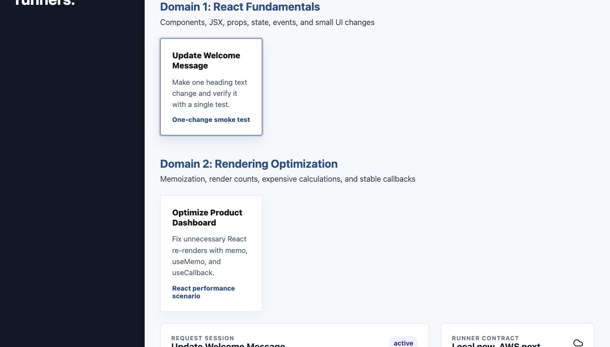
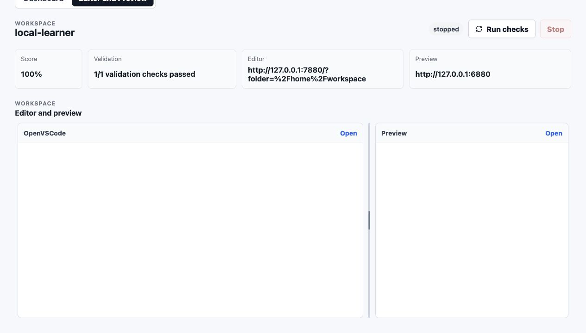

# Learning Lab Platform

Browser-based coding labs backed by Convex for control-plane state and local Docker/OpenVSCode for disposable execution environments.

The current MVP is a single-operator local platform for React scenarios. It lets you seed scenarios, request a session, open OpenVSCode, view the Vite preview, run learner-triggered checks, inspect validation results/events, and stop or expire sessions.

AWS remains the intended hosted runner path, but the working MVP is local-first.

## Screenshots

Scenario catalog and session request flow:



Editor and preview workspace:



## Architecture

- React/Vite frontend for the learner/admin UI.
- Convex schema and functions for labs, sessions, and session events.
- Lab manifests under `lab-definitions/`.
- Local runner integration under `runner/`.
- Future AWS infrastructure isolated under `infra/`.

Each local session is container/process-backed: a copied Node workspace, OpenVSCode editor, Vite preview, tools/check server, and a `Run checks` action that runs Vitest.

## Current Scenarios

Use `Seed scenarios` in the dashboard to create or update the MVP scenarios in Convex:

- `Update Welcome Message`: React Fundamentals smoke scenario. Change one heading to `Welcome to React Labs`.
- `Optimize Product Dashboard`: Rendering Optimization scenario based on the existing React performance lab.

Scenario manifests are documented in [docs/scenario-authoring.md](docs/scenario-authoring.md). After changing a manifest, run:

```bash
npm run scenarios:import
```

Before marking a new scenario ready, run its starter/solution smoke test:

```bash
npm run scenarios:smoke -- --scenario react-button-label
```

## Local Setup

```bash
npm install
cp .env.example .env.local
npx convex dev
npm run dev
```

After `convex dev` starts, set `VITE_CONVEX_URL` in `.env.local` to the URL it prints.

Docker Desktop must be running before processing sessions because the default local editor provider starts OpenVSCode with `gitpod/openvscode-server:latest`.

## Optional: Reimport The Product Dashboard Lab

```bash
npm run import:react-lab
```

This copies the starter and solution exercise folders into `lab-definitions/react-product-dashboard/workspace-template/` so runner experiments can mount or package them without depending on the original path. The checked-in MVP already includes the current scenario templates, so this command is only needed when refreshing the product dashboard lab from its source.

## Control Plane And Runner

Convex owns durable state:

- lab definitions
- learner sessions
- runner status
- validation results
- event timeline

The local runner owns ephemeral execution:

- one session workspace per learner
- OpenVSCode Docker container
- workspace filesystem
- Vite preview
- tools/check server
- validation command execution

The future AWS runner should preserve this boundary: Convex remains the control plane, and hosted runner infrastructure owns per-session execution.

## Complete Local MVP Workflow

1. Start Convex: `npx convex dev`.
2. Start the dashboard: `npm run dev`.
3. Confirm Docker Desktop is running.
4. Start the local runner: `npm run runner:local`.
5. Open the dashboard at `http://127.0.0.1:5174/`.
6. Click `Seed scenarios`.
7. Select a scenario card.
8. Click `Request session`.
9. Wait for the session to move from `requested` to `running`.
10. Open the `Editor and Preview` tab or the session detail links:
   - `Workspace` opens OpenVSCode.
   - `Preview` opens the Vite app.
   - `Tools` opens validation controls.
11. Complete the exercise in OpenVSCode and save the file.
12. Use `Run checks` from either the dashboard or tools page.
13. Use `Stop` from the dashboard to request cleanup. The running local runner performs actual Docker/process cleanup on its next poll.

## Run The Local Runner

After Convex is configured and scenarios are seeded from the UI:

```bash
npm run runner:local
```

For supervised local development, start Convex, the dashboard, and the local runner together:

```bash
npm run dev:all
```

By default this supervised mode uses `LOCAL_EDITOR_PROVIDER=lightweight` so it can run without Docker. Set `LOCAL_EDITOR_PROVIDER=openvscode-docker` if you want the full OpenVSCode Docker editor while using the supervisor.

For a one-shot poll:

```bash
npm run runner:local:once
```

The runner processes requested local sessions, creates a workspace under `lab-workspaces/`, installs dependencies, starts OpenVSCode, starts Vite preview, starts the tools/check server, and marks the session `running`. It does not run validation on startup; the learner or operator starts validation with `Run checks` from the dashboard or tools page.

Each runner poll also reconciles Convex state with local state. Sessions left in `starting` after a runner restart are rebuilt idempotently, and active local sessions are checked against their editor, preview, and tools processes. If a required process or editor container has died, the runner marks the session errored, records an event, and cleans up remaining local resources.

If a requested local session stays queued, confirm `npm run runner:local` is still running. The dashboard shows a queued-session notice when local sessions are waiting for the runner.

By default, the local runner expects Docker Desktop and starts OpenVSCode with `gitpod/openvscode-server:latest`. To use a native OpenVSCode binary instead, set:

```bash
LOCAL_EDITOR_PROVIDER=openvscode-native
OPENVSCODE_SERVER_BIN=/path/to/openvscode-server
```

## Session Cleanup

The dashboard `Stop` button marks the session as stopped in Convex. The local runner performs actual cleanup on its next poll:

- stops the Vite preview process
- stops the tools server process
- stops the OpenVSCode Docker container
- records cleanup metadata in Convex

Expired sessions are handled the same way. The runner marks them `expired`, cleans local resources, and records a cleanup event.

## Troubleshooting

- Docker socket permission errors: run the runner with Docker access, confirm Docker Desktop is started, and verify `docker info` works.
- Port already in use: the local runner scans for the next available port near the deterministic session port; rerun the runner if a stale process still occupies a port.
- OpenVSCode image pull/start failures: run `docker pull gitpod/openvscode-server:latest`, or switch to `LOCAL_EDITOR_PROVIDER=openvscode-native`.
- Convex URL mismatch: confirm `.env.local` has the same `VITE_CONVEX_URL` printed by `npx convex dev`.
- Session stuck in `requested`: start or restart `npm run runner:local`; Convex has queued the session, but no local runner is polling.
- Check fails after editing: save the file in OpenVSCode and read the validation failure message. The welcome scenario reports the actual heading found by Vitest.
- Stale sessions/containers: click `Stop`, run `npm run runner:local:once`, then verify with `docker ps`.
