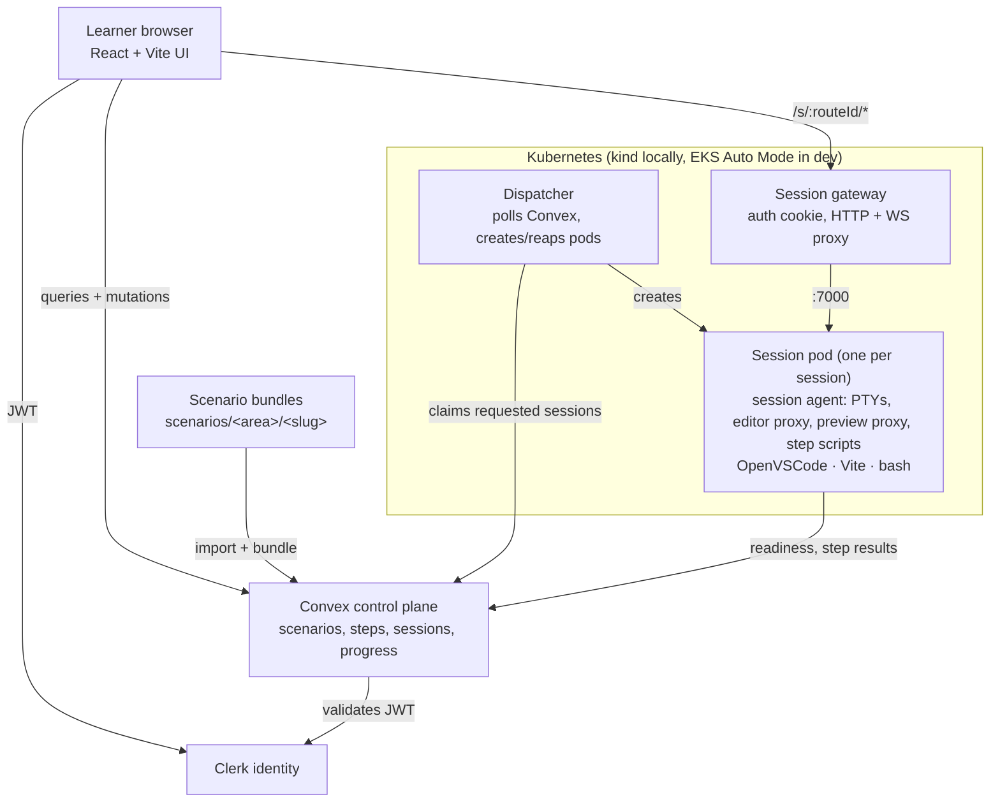

# Learning Lab Platform

Browser-based, Killercoda-style learning labs: terminal-first scenarios with
step-by-step instructions, plus OpenVSCode and a live preview for React
exercises. Convex is the control plane; every learner session is a Kubernetes
pod — `kind` locally, EKS in `dev`.

> **Status (2026-10-23):** the platform is being redesigned. Phase 0 (decisions
> and cleanup) and Phase 1 (scenario manifest v2 and content) are done; the
> session agent and Kubernetes dispatcher are next. See [`ROADMAP.md`](ROADMAP.md) for the status board and
> [`docs/2026-10-22/redesign-plan.md`](docs/2026-10-22/redesign-plan.md) for
> the design. Until Phase 3 lands, the legacy local Docker runner below is
> still the way to run a session.

## Target experience

Reference screenshots are in [`docs/2026-10-22/`](docs/2026-10-22/).

1. **Areas** — a searchable grid of topics (Linux, Git, Node, React, …).
2. **Scenarios** — cards per area, with a check mark once completed.
3. **Scenario shell** — instructions on the left (`START` → steps with
   `BACK`/`NEXT` and verification → finish), a tabbed workspace on the right
   (`Terminal`, `Editor`, `Preview`, `+`), TTL countdown in the header.

## Architecture



Decisions: [`docs/decisions/`](docs/decisions/). The redesign is ADR 0005
(Kubernetes), 0006 (manifest v2), and 0007 (local + dev only). The design intent of ADRs
0002–0004 (workspace storage, routing, secure session access) carries over;
their ECS-specific mechanics are replaced by ADR 0005.

## Environments

| | local | dev |
|---|---|---|
| Cluster | `kind` on Docker Desktop | EKS Auto Mode, `us-east-2` |
| Frontend | Vite dev server | S3 + CloudFront |
| Convex | `npx convex dev` | `prod:upbeat-crab-254` |
| Clerk | development instance, optional | development instance, required |

Full detail in [`config/hosted-environments.json`](config/hosted-environments.json)
and ADR 0007. AWS infrastructure lives under [`infra/aws/`](infra/aws/README.md).

## Repository layout

| Path | Purpose |
|---|---|
| `src/` | React frontend (being rewritten in Phase 4) |
| `convex/` | Control plane: schema, sessions, scenarios, progress, access |
| `runner/` | Session execution: legacy local Docker runner today; session agent, dispatcher, gateway from Phase 2–3 |
| `scenarios/` | Scenario catalog (manifest v2): `<area>/area.json`, `<area>/<slug>/` with steps, scripts, and react workspaces |
| `scripts/` | Import, smoke test, dev supervisor |
| `infra/aws/` | Terraform: state backend, account security, (Phase 5) EKS platform + `dev` root |
| `docs/` | Design, decisions, authoring guide, manual test scripts |

## Local setup (legacy runner, until Phase 3 — React scenarios only)

```bash
npm install
cp .env.example .env.local
npx convex dev          # copy the printed URL into VITE_CONVEX_URL in .env.local
npm run dev:all         # convex dev + vite + local runner, supervised
```

Docker Desktop must be running: the local runner starts OpenVSCode with
`gitpod/openvscode-server:latest`. Then open the dashboard, click
`Seed scenarios`, pick a React scenario, and `Request session`. Terminal
scenarios (`git`, `linux`, `node`) need the Kubernetes runner from Phase 3;
until then they are only exercised by `npm run scenarios:smoke`.

Keep `VITE_PRODUCT_SURFACE=local`, `VITE_AUTH_MODE=disabled`,
`VITE_SESSION_ACCESS_MODE=local-only`, and `VITE_COST_CONTROLS_MODE=local-limits`
for local development. Account setup for configured auth is in
[`docs/user-accounts.md`](docs/user-accounts.md).

Useful commands:

```bash
npm run runner:local:once     # one dispatcher poll
npm run scenarios:import      # re-import manifests after editing
npm run scenarios:smoke -- --scenario first-commit   # or --local to skip Docker
npm run test:runner           # unit tests for convex/, scripts/, runner/
npm run lint && npm run build
```

Scenario authoring: [`docs/scenario-authoring.md`](docs/scenario-authoring.md).

## Troubleshooting (legacy runner)

- Session stuck in `requested`: the runner is not polling — run `npm run runner:local`.
- Docker errors: confirm `docker info` works; `docker pull gitpod/openvscode-server:latest`.
- Convex URL mismatch: `.env.local` must match the URL printed by `npx convex dev`.
- Stale containers: `Stop` in the dashboard, then `npm run runner:local:once`, then `docker ps`.
