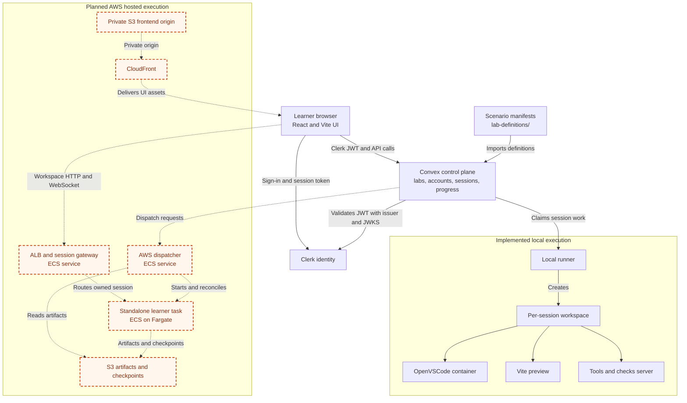
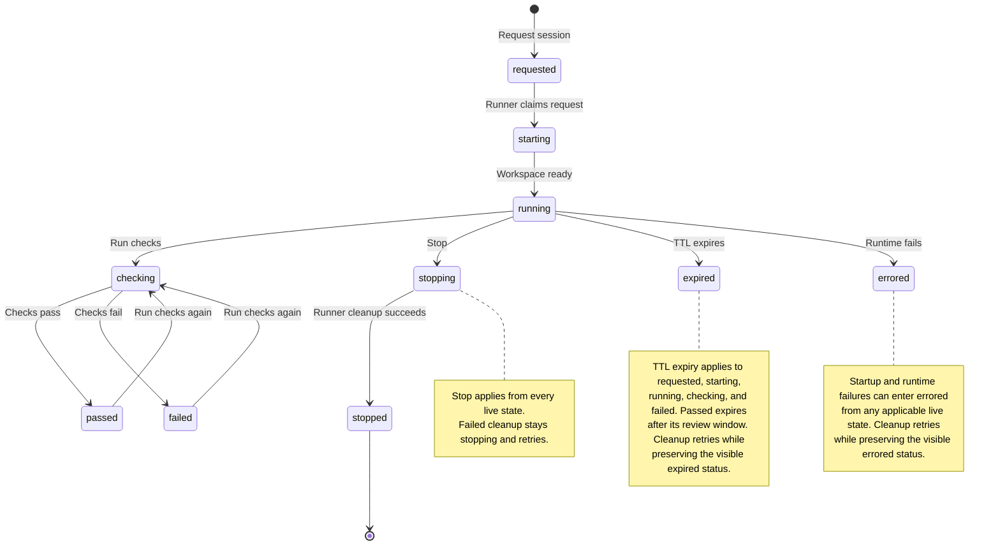

# Learning Lab Platform

Browser-based coding labs backed by Convex for control-plane state and local Docker/OpenVSCode for disposable execution environments.

The current MVP is a single-operator local platform for React scenarios. It lets you seed scenarios, request a session, open OpenVSCode, view the Vite preview, run learner-triggered checks, inspect validation results/events, and stop or expire sessions.

AWS remains the intended hosted runner path, but the working MVP is local-first.

## Screenshots

Scenario catalog and session request flow:


Editor and preview workspace:


## Architecture

Solid lines show the implemented local and control-plane paths. Dashed lines
show the planned hosted path from the [AWS Hosted Launch Plan](ROADMAP.md#aws-hosted-launch-plan).



| Component | Owns | Runtime status |
| --- | --- | --- |
| React/Vite application | Learner dashboard and local platform controls | Implemented |
| Clerk | Hosted identity, sign-in, sign-out, and account management | Implemented for configured auth |
| Convex | Labs, accounts, session state, progress, events, session ownership checks, and runner coordination | Implemented |
| Local runner | Local workspace creation, process lifecycle, checks, and cleanup | Implemented and preserved |
| AWS dispatcher | Idempotent Fargate launch, reconciliation, registration, and cleanup | Planned ECS service |
| Session gateway | Authenticated HTTP and WebSocket routing to private learner tasks | Planned ECS service |
| Learner session task | One isolated interactive workspace for one learner session | Validation image proven in Fargate; interactive runtime planned |
| S3 artifact storage | Immutable scenarios and bounded workspace checkpoints | Infrastructure provisioned; application workflow planned |

Each local session is container/process-backed: a copied Node workspace, OpenVSCode editor, Vite preview, tools/check server, and a `Run checks` action that runs Vitest.

### Session Lifecycle

`stopping` is intentionally separate from `stopped`. A Stop request first
blocks further workspace activity, then the runner removes the actual runtime
resources. Only successful cleanup produces the final `stopped` state.



## Current Scenarios

Use `Seed scenarios` in the dashboard to create or update the active MVP scenarios in Convex:

| Scenario | Domain | Exercise |
| --- | --- | --- |
| Update Welcome Message | React Fundamentals | Change a heading and verify the exact text. |
| Update Button Label | React Fundamentals | Clarify a primary action with a one-button JSX edit. |
| Add Empty State Message | React Fundamentals | Render helpful guidance when a task list is empty. |
| Optimize Product Dashboard | Rendering Optimization | Prevent unnecessary renders with stable memoization. |

Seeding also creates the default `React Labs` course and module records used to group scenarios above the individual exercise level.

Scenario manifests are documented in [docs/scenario-authoring.md](docs/scenario-authoring.md). After changing a manifest, run:

```bash
npm run scenarios:import
```

Before marking a new scenario ready, run its starter/solution smoke test:

```bash
npm run scenarios:smoke -- --scenario react-button-label
```

Product readiness decisions are documented in [docs/product-readiness.md](docs/product-readiness.md). The first product surface is self-serve: learners select an exercise, the platform starts the needed session/workspace automatically, and learners can stop or exit their exercise at any time.

Manual verification steps for product readiness are documented in [docs/product-readiness-manual-testing.md](docs/product-readiness-manual-testing.md).

## Local Setup

```bash
npm install
cp .env.example .env.local
npx convex dev
npm run dev
```

After `convex dev` starts, set `VITE_CONVEX_URL` in `.env.local` to the URL it prints.

Docker Desktop must be running before processing sessions because the default local editor provider starts OpenVSCode with `gitpod/openvscode-server:latest`.

Hosted or public product surfaces must configure authentication, authorized session/workspace URL access, and cost controls before the app starts. Keep `VITE_PRODUCT_SURFACE=local`, `VITE_AUTH_MODE=disabled`, `VITE_SESSION_ACCESS_MODE=local-only`, and `VITE_COST_CONTROLS_MODE=local-limits` for local development; set `VITE_AUTH_MODE=configured`, `VITE_SESSION_ACCESS_MODE=authorized`, and `VITE_COST_CONTROLS_MODE=enforced` before using `VITE_PRODUCT_SURFACE=hosted` or `public`.

User account setup is documented in [docs/user-accounts.md](docs/user-accounts.md). Configured authentication uses Clerk's React SDK and Convex integration. Local auth-disabled development remains available.

## Optional: Reimport The Product Dashboard Lab

```bash
npm run import:react-lab
```

This copies the starter and solution exercise folders into `lab-definitions/react-product-dashboard/workspace-template/` so runner experiments can mount or package them without depending on the original path. The checked-in MVP already includes the current scenario templates, so this command is only needed when refreshing the product dashboard lab from its source.

## Control Plane And Runner

Convex owns durable state:

- lab definitions
- learner sessions
- runner status
- validation results
- event timeline

The local runner owns ephemeral execution:

- one session workspace per learner
- OpenVSCode Docker container
- workspace filesystem
- Vite preview
- tools/check server
- validation command execution

The future AWS runner should preserve this boundary: Convex remains the control plane, and hosted runner infrastructure owns per-session execution.

| Concern | Convex control plane | Runner execution plane |
| --- | --- | --- |
| Durable scenario and progress data | Owns | Reads only what a session requires |
| Session lifecycle state | Authoritative record | Reconciles real resources into that record |
| Workspace files and processes | Stores metadata only | Owns ephemeral runtime resources |
| Validation | Stores results and events | Executes the scenario command |
| Stop and expiry | Records intent and policy | Removes resources, then confirms cleanup |
| Hosted credentials | Validates scoped identity | Learner tasks must never receive reusable platform credentials |

## Complete Local MVP Workflow

1. Start Convex: `npx convex dev`.
2. Start the dashboard: `npm run dev`.
3. Confirm Docker Desktop is running.
4. Start the local runner: `npm run runner:local`.
5. Open the dashboard at `http://127.0.0.1:5174/`.
6. Click `Seed scenarios`.
7. Select a scenario card.
8. Click `Request session`.
9. Wait for the session to move from `requested` to `running`.
10. Open the `Editor and Preview` tab or the session detail links:
   - `Workspace` opens OpenVSCode.
   - `Preview` opens the Vite app.
   - `Tools` opens validation controls.
11. Complete the exercise in OpenVSCode and save the file.
12. Use `Run checks` from either the dashboard or tools page.
13. Use `Stop` from the dashboard to request cleanup. The running local runner performs actual Docker/process cleanup on its next poll.

## Run The Local Runner

After Convex is configured and scenarios are seeded from the UI:

```bash
npm run runner:local
```

For supervised local development, start Convex, the dashboard, and the local runner together:

```bash
npm run dev:all
```

By default this supervised mode uses `LOCAL_EDITOR_PROVIDER=openvscode-docker`, matching the local runner's OpenVSCode editor path. Set `LOCAL_EDITOR_PROVIDER=lightweight` only when you explicitly want the fallback textarea editor without Docker.

For a one-shot poll:

```bash
npm run runner:local:once
```

The runner processes requested local sessions, creates a workspace under `lab-workspaces/`, installs dependencies, starts OpenVSCode, starts Vite preview, starts the tools/check server, and marks the session `running`. It does not run validation on startup; the learner or operator starts validation with `Run checks` from the dashboard or tools page.

Each runner poll also reconciles Convex state with local state. Sessions left in `starting` after a runner restart are rebuilt idempotently, and active local sessions are checked against their editor, preview, and tools processes. If a required process or editor container has died, the runner marks the session errored, records an event, and cleans up remaining local resources.

The runner health panel includes recent observability metrics for startup time, validation time, failure rate, and cleanup time.

Completed local workspaces remain inspectable for 30 minutes after a passing validation run. Passing validation records `completedAt` and moves `expiresAt` to the end of that review window; after it elapses, the runner expires and cleans the local editor, preview, and tools resources through the normal TTL cleanup path.

The dashboard keeps scenario attempt summaries in durable `progressRecords`, one row per requested session. These records are separate from disposable session runtime metadata, so scenario progress can remain available after a local workspace has been stopped, expired, hidden from the recent-session list, or cleaned up.

Manual verification steps for these flows are documented in [docs/session-progress-manual-testing.md](docs/session-progress-manual-testing.md).

If a requested local session stays queued, confirm `npm run runner:local` is still running. The dashboard shows a queued-session notice when local sessions are waiting for the runner.

By default, the local runner expects Docker Desktop and starts OpenVSCode with `gitpod/openvscode-server:latest`. To use a native OpenVSCode binary instead, set:

```bash
LOCAL_EDITOR_PROVIDER=openvscode-native
OPENVSCODE_SERVER_BIN=/path/to/openvscode-server
```

## Session Cleanup

The dashboard `Stop` button moves the session to `stopping` in Convex. The local runner performs actual cleanup on its next poll:

- stops the Vite preview process
- stops the tools server process
- stops the OpenVSCode Docker container
- records cleanup metadata in Convex

After those operations succeed, the runner moves the session to `stopped`.
If cleanup fails, the session remains `stopping` so reconciliation can retry
without falsely claiming that its resources are gone.

Expired sessions are handled the same way. The runner marks them `expired`, cleans local resources, and records a cleanup event.

## Troubleshooting

- Docker socket permission errors: run the runner with Docker access, confirm Docker Desktop is started, and verify `docker info` works.
- Port already in use: the local runner scans for the next available port near the deterministic session port; rerun the runner if a stale process still occupies a port.
- OpenVSCode image pull/start failures: run `docker pull gitpod/openvscode-server:latest`, or switch to `LOCAL_EDITOR_PROVIDER=openvscode-native`.
- Convex URL mismatch: confirm `.env.local` has the same `VITE_CONVEX_URL` printed by `npx convex dev`.
- Session stuck in `requested`: start or restart `npm run runner:local`; Convex has queued the session, but no local runner is polling.
- Check fails after editing: save the file in OpenVSCode and read the validation failure message. The welcome scenario reports the actual heading found by Vitest.
- Stale sessions/containers: click `Stop`, run `npm run runner:local:once`, then verify with `docker ps`.
