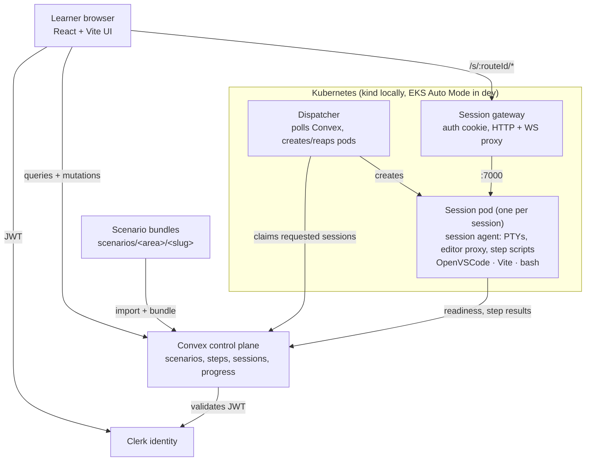

# Learning Lab Platform

Browser-based, Killercoda-style learning labs: terminal-first scenarios with
step-by-step instructions, plus OpenVSCode and a live preview for React
exercises. Convex is the control plane; every learner session is a Kubernetes
pod — `kind` locally, EKS in `dev`.

> **Status (2026-10-27):** the platform is being redesigned. Phases 0–1 are
> done (decisions, scenario catalog v2); Phase 2 (the session image and agent)
> is code complete, pending an image build and Docker integration run; Phase 3
> (Kubernetes dispatcher, gateway, kind + Helm) is code complete, pending a
> cluster run; the Phase 4 shell is next. See [`ROADMAP.md`](ROADMAP.md) for the status board and
> [`docs/2026-10-22/redesign-plan.md`](docs/2026-10-22/redesign-plan.md) for
> the design.

## Target experience

Reference screenshots are in [`docs/2026-10-22/`](docs/2026-10-22/).

1. **Areas** — a searchable grid of topics (Linux, Git, Node, React, …).
2. **Scenarios** — cards per area, with a check mark once completed.
3. **Scenario shell** — instructions on the left (`START` → steps with
   `BACK`/`NEXT` and verification → finish), a tabbed workspace on the right
   (`Terminal`, `Editor`, `Preview`, `+`), TTL countdown in the header.

## Architecture



Decisions: [`docs/decisions/`](docs/decisions/). The redesign is ADR 0005
(Kubernetes), 0006 (manifest v2), and 0007 (local + dev only). The design intent of ADRs
0002–0004 (workspace storage, routing, secure session access) carries over;
their ECS-specific mechanics are replaced by ADR 0005.

## Environments

| | local | dev |
|---|---|---|
| Cluster | `kind` on Docker Desktop | EKS Auto Mode, `us-east-2` |
| Frontend | Vite dev server | S3 + CloudFront |
| Convex | `npx convex dev` | `prod:upbeat-crab-254` |
| Clerk | development instance, optional | development instance, required |

Full detail in [`config/hosted-environments.json`](config/hosted-environments.json)
and ADR 0007. AWS infrastructure lives under [`infra/aws/`](infra/aws/README.md);
setting up and deploying `dev` is [`docs/dev-environment.md`](docs/dev-environment.md)
(`npm run infra:dev:apply`, then `npm run deploy:dev`).

## Repository layout

| Path | Purpose |
|---|---|
| `src/` | React frontend: areas → scenarios → scenario shell (`pages/`, `components/`, `lib/useScenarioSession.ts`) |
| `convex/` | Control plane: schema, sessions, scenarios, progress, access |
| `runner/` | `session-agent/` (inside each session pod), `dispatcher/` (Convex → pods), `gateway/` (ADR 0004 ingress), `shared/` |
| `deploy/` | Helm chart (`helm/learning-lab`) and the kind cluster template |
| `images/` | `session-workspace` (per-session: agent, OpenVSCode, Node, git) and `platform` (dispatcher + gateway) |
| `scenarios/` | Scenario catalog (manifest v2): `<area>/area.json`, `<area>/<slug>/` with steps, scripts, and react workspaces |
| `scripts/` | Import, smoke tests, dev supervisor, `deploy-dev.mjs`, `publish-scenarios.mjs` |
| `infra/aws/` | Terraform: state backend, account security, `modules/eks-platform` + the `environments/dev` root |
| `docs/` | Design, decisions, authoring guide, manual test scripts |

## Local setup

Requires Node 22, Docker Desktop, `kind`, `kubectl`, and `helm`
(`brew install kind kubectl helm`).

```bash
npm install
cp .env.example .env.local           # set RUNNER_SHARED_SECRET
npx convex dev                       # copy the printed URL into VITE_CONVEX_URL in .env.local
npx convex env set RUNNER_SHARED_SECRET <same value>
npx convex env set ALLOW_UNAUTHENTICATED_LOCAL_MODE true
npm run dev:all                      # convex dev + vite + `cluster up` (kind, images, Helm chart)
```

Then open **http://app.lab.localhost:8080**. The gateway proxies the Vite
dev server under the app host, so the app and the session endpoints
(`ws-<id>.lab.localhost`, `pv-<id>.lab.localhost`) are same-site and the
workspace cookie set by `POST /__llp/bootstrap` is sent; `http://localhost:5174`
renders the catalog but cannot open a workspace. Go to `/admin` once and click
`Seed scenarios`, then pick an area and a scenario: the shell requests a
session, waits for the pod, bootstraps access, and shows the terminal (and the
editor/preview tabs for React scenarios). Sessions run as pods on the kind
cluster behind the gateway at `http://127.0.0.1:8080`; `npm run gateway:smoke`
proves the same path from the command line.

Keep `VITE_PRODUCT_SURFACE=local` and `VITE_AUTH_MODE=disabled` for local
development (`VITE_LEARNER_LABEL` names the local learner, default `learner`).
Account setup for configured auth is in
[`docs/user-accounts.md`](docs/user-accounts.md).

Useful commands:

```bash
npm run cluster:status        # pods + dispatcher/gateway logs
npm run cluster:deploy        # after changing runner/ or images/
npm run scenarios:import      # re-import manifests after editing
npm run scenarios:smoke -- --scenario first-commit
npm run agent:integration     # drive the session image over Docker
npm run test:runner           # unit tests for convex/, scripts/, runner/
npm run test:web              # unit tests for the frontend's pure pieces (src/lib)
npm run lint && npm run build
npm run infra:dev:plan        # Terraform for dev (docs/dev-environment.md)
npm run deploy:dev            # images → convex → chart → dns → scenarios → frontend
```

Scenario authoring: [`docs/scenario-authoring.md`](docs/scenario-authoring.md).

## Troubleshooting

- Session stuck in `requested`: the dispatcher is not running or cannot reach Convex — `npm run cluster:status`.
- Session `errored` with "did not become ready": `kubectl -n sessions describe pod <podName>`; usually the image is not loaded into kind (`npm run cluster:deploy`) or the scenario mount is missing.
- Gateway 401 in the browser: bootstrap the host first (the Phase 4 shell does this; `npm run gateway:smoke -- --keep` prints a one-time dev link).
- Convex URL mismatch: `.env.local` must match the URL printed by `npx convex dev`, and `RUNNER_SHARED_SECRET` must match the Convex env.
- Dashboard shows "Blocked request. This host is not allowed" under `app.lab.localhost`: `vite.config.ts` must list `.lab.localhost` and `host.docker.internal` in `server.allowedHosts` (it does by default).
- `kind load docker-image` fails (containerd import errors, Docker Desktop quirks): `docker save learning-lab/platform:dev -o build/platform.tar && kind load image-archive build/platform.tar --name learning-lab` (same for the session image).
- `npm run dispatcher:once` from this machine: scale the in-cluster dispatcher to 0 first (`kubectl -n learning-lab scale deploy/llp-dispatcher --replicas=0`), otherwise it holds the lease and the local tick is skipped; scale back to 1 afterwards.
- Helm reports the release as `pending-upgrade`/`pending-install` (an interrupted deploy): `npm run cluster:deploy` rolls back or uninstalls it automatically before upgrading.
